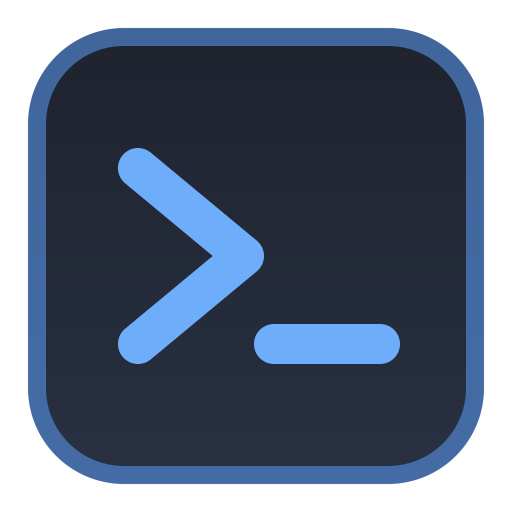
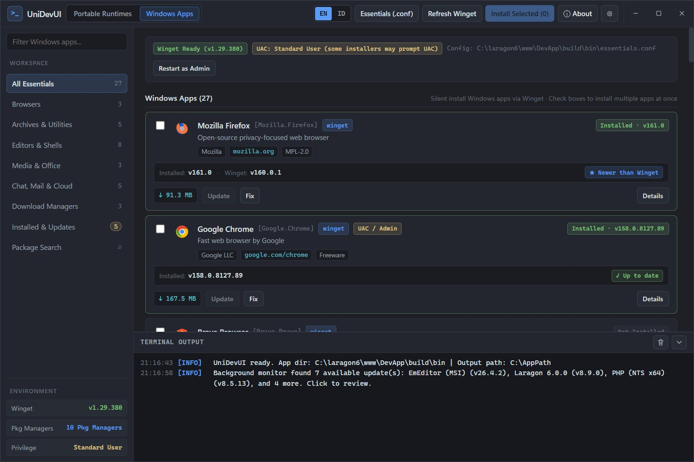
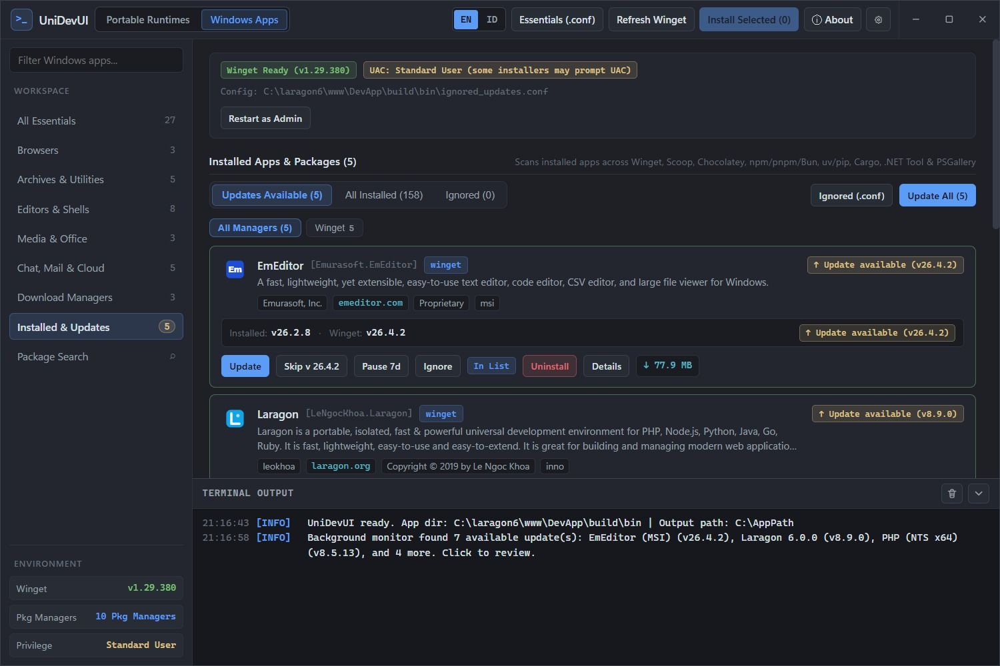
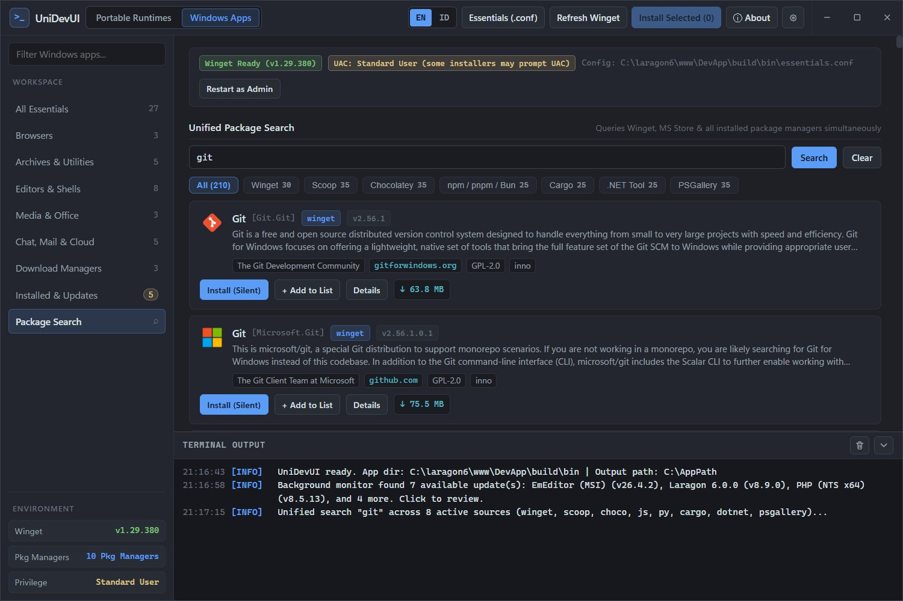
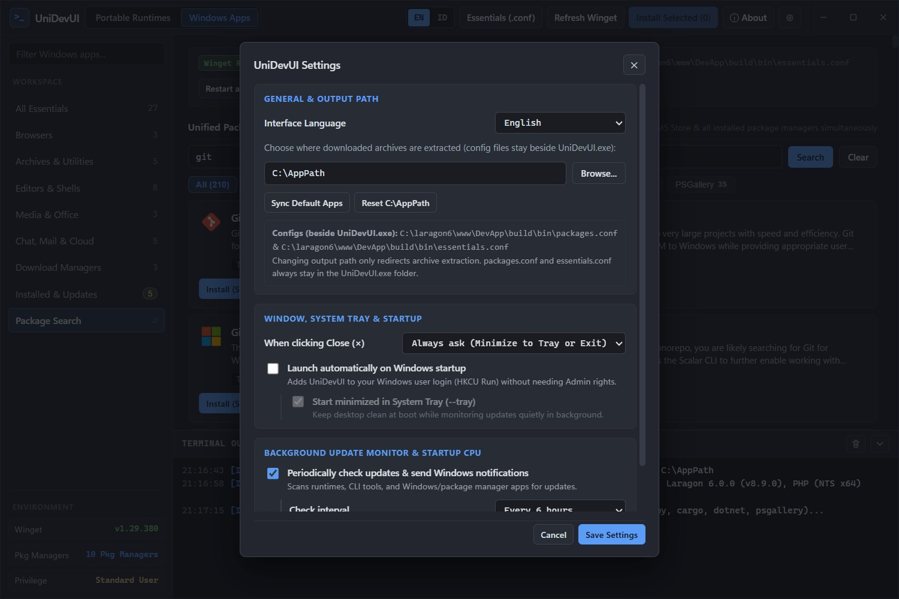

<div align="center">



# UniDevUI

**Manajer Runtime Developer Portabel, Hub Multi-Package Manager & Pemantau Update Senyap di System Tray**

[English](README.md) · [Bahasa Indonesia](README.id.md) · [Changelog](CHANGELOG.md) · [Rilis GitHub](https://github.com/aozora-kenzu/UniDevUI/releases)

[](https://github.com/aozora-kenzu/UniDevUI/releases/latest)
[](https://github.com/aozora-kenzu/UniDevUI/actions/workflows/release.yml)
[-0078D6?style=for-the-badge&logo=windows&logoColor=white)](https://github.com/aozora-kenzu/UniDevUI/releases)
[](go.mod)
[](wails.json)
[](frontend/package.json)
[](LICENSE)
[](https://github.com/aozora-kenzu/UniDevUI/releases)

</div>

---

**UniDevUI** adalah aplikasi desktop Windows portabel dalam bentuk satu file `.exe` berbasis **Go + Wails v2 + Vanilla TypeScript**. Dirancang untuk menyiapkan runtime pemrograman di folder portabel (`C:\AppPath` secara default) tanpa mengotori sistem operasi lewat pengaturan `HKCU\Environment` User `PATH`, sekaligus menyatukan manajemen aplikasi Windows (Winget), 10 package manager CLI, pencarian lintas repositori, progress ConPTY, serta pemantau update hemat daya di System Tray.

---

## Tangkapan Layar

### 1. Portable Runtimes, CLI Tools & Manajemen User PATH Aman
Kelola versi runtime terpasang (`node`, `php`, `composer`, `go`, `git`, `python`, `dotnet`, `rust`, dll.), tools CLI/SDK, 10 package manager, dan User `PATH` pada tampilan frameless gelap dengan sidebar penuh dan drawer Terminal Output yang rapi.


### 2. Katalog Aplikasi Windows Kurasi (`Windows Apps`)
Dilengkapi checkbox instalasi batch lewat tombol header `Install Selected`, indikator UAC, deteksi lintas Registry & Winget, serta perbandingan versi terpasang terhadap versi Winget terbaru untuk 27 aplikasi esensial kurasi.



### 3. Aplikasi Terpasang, Update Sistem & Kontrol Pengecualian
Pantau semua aplikasi/paket dari **Winget** dan **CLI package manager**, perbarui satu per satu atau sekaligus lewat **`Update All`**, gunakan **`Skip v...`** (lewati versi spesifik), **`Pause 7d` / `Jeda 7h`** (tunda update 7 hari), atau **`Ignore`** (beserta kunci `winget pin`).



### 4. Pencarian Paket Lintas Sumber (`Unified Package Search`)
Cari paket secara serentak dari **Winget**, **Microsoft Store**, **Scoop**, **Chocolatey**, **npm / pnpm / Bun**, **PyPI (`pip` / `uv`)**, **Cargo**, **.NET Tool**, dan **PowerShell Gallery**, lengkap dengan ikon UniGetUI, penerbit, lisensi, dan ukuran installer.



### 5. Pengaturan: System Tray, Startup Senyap (`--tray`) & Optimasi CPU
Atur folder ekstraksi, aksi tombol tutup (`Tanya`, `Sembunyikan ke Tray`, `Keluar`), auto-start senyap saat startup Windows (`--tray`), serta jadwal pemantau update otomatis dan penundaan scan startup.



---

## Fitur Unggulan

### Portable Runtimes, Compiler & `HKCU` User PATH
- **13 Paket Arsip Portabel Bawaan** diekstrak ke folder khusus (default `C:\AppPath`, dapat diganti dari Pengaturan):
  - **Core Runtimes (8):** `node` (Node.js LTS), `php` (NTS x64), `composer` (otomatis membuat `composer.bat`), `go`, `git` (MinGit), `pocketbase`, `sqlite`, `python` (CPython standalone oleh Astral + wrapper `pip.bat`)
  - **Dev Stack & Compiler (5):** `dotnet` (.NET SDK LTS), `rust`, `gcc` (WinLibs GCC/MinGW-w64), `cmake`, `7zip`
- **Manajemen User `PATH` (`HKCU\Environment`):** Ganti versi aktif seketika, deteksi bentrok dengan biner global sistem, atur urutan prioritas, bersihkan path tidak valid, atau buka folder langsung.
- **5 Installer CLI & Windows SDK:** `wails2`, `wails3`, `tauri`, `vsbuildtools` (Visual Studio 2022 Build Tools), dan `webview2` (Edge WebView2 Runtime).
- **10 Package Manager Terintegrasi:** Deteksi & instalasi untuk `scoop`, `choco`, `npm`, `pnpm`, `bun`, `uv`, `pip`, `cargo`, `dotnet`, dan `psgallery` (mendukung wrapper `.bat`/`.cmd` dan melewati stub `WindowsApps` 0-byte).

### Hub Aplikasi Windows & Multi-Package Manager
- **27 Aplikasi Esensial Kurasi** dalam 6 kategori (`browsers`, `utilities`, `editors`, `office`, `chat`, `downloaders`), termasuk pilihan multi-versi seperti **Laragon** (`6.0.0` atau `latest`).
- **Unified Package Search Real-time:** Streaming hasil paralel lintas Winget, MS Store, Scoop, Chocolatey, JS, Python, Rust Cargo, .NET Tool, dan PSGallery dengan modal Detail lengkap (ikon, penerbit, lisensi, dependensi, SHA256, ukuran unduhan).
- **Kebijakan Pengecualian Update Fleksibel (`ignored_updates.conf`):**
  - **Lewati Versi (`Skip v...`):** Mengabaikan satu versi tertentu dan tetap memberitahu saat versi lebih baru rilis.
  - **Jeda Sementara (`Jeda 7h`):** Menulis `pause_until` berjangka 7 hari yang otomatis aktif kembali setelah tanggal jeda berakhir (atau lanjutkan manual lewat **Lanjutkan**).
  - **Abaikan Permanen & Winget Pin:** Menambahkan `winget pin add --blocking` otomatis agar `winget upgrade` sistem ikut menghormatinya.
- **Progress ConPTY Bersih:** Memanfaatkan `CreatePseudoConsole` agar persentase, MB terunduh, dan kecepatan unduh tampil rapi pada progress bar header.

### Daemon System Tray Senyap & Optimasi Daya Windows *(Baru di v1.1.2)*
- **Startup Windows Senyap di System Tray (`--tray`):** Ketika PC baru menyala atau restart, UniDevUI otomatis berjalan tersembunyi di System Tray tanpa memunculkan jendela utama (kecuali memang dibuka manual oleh pengguna).
- **Badge Status Tray Dinamis & Menu Navigasi:** Merender ikon Tray 32×32 dengan titik indikator — netral (`idle`), **Hijau** (ada update tersedia + jumlahnya, otomatis hilang bila `0` update), **Biru** (sedang sibuk), **Oranye** (peringatan/error), beserta pintasan ke `Runtimes & Dev Stack`, `Pembaruan (N)`, dan `Cari Paket`.
- **Windows Efficiency Mode (EcoQoS) & Pemangkasan Memori:** Mengaktifkan `ProcessPowerThrottling` (`ExecutionSpeed`) secara otomatis ketika berada di Tray / diminimalkan tanpa tugas aktif, menonaktifkannya saat jendela dibuka kembali, serta memanggil `debug.FreeOSMemory()`.
- **Hook Shutdown Windows, Penjaga Baterai/Jaringan & Cooldown:** Menangani `WM_QUERYENDSESSION`/`WM_ENDSESSION` agar restart/shutdown Windows berjalan mulus tanpa modal blokir, menunda scan otomatis saat offline atau Mode Hemat Baterai aktif, menyimpan `lastCheckUnix` agar scan startup tidak berulang dalam interval jadwal, serta menahan popup notifikasi toast bila jendela UniDevUI sudah terbuka aktif di layar (**Smart Toast Suppression**).
- **Self-Updater Bawaan & Dwibahasa:** Ganti bahasa instan **English (`en`)** ↔ **Indonesia (`id`)** serta cek dan terapkan rilis terbaru langsung dari menu **Tentang**.

---

## Lokasi Konfigurasi & Penyimpanan

| Berkas | Lokasi | Fungsi |
| :--- | :--- | :--- |
| `packages.conf` | Di sebelah `UniDevUI.exe` | Daftar paket runtime portabel, versi, dan tautan unduhan resmi |
| `essentials.conf` | Di sebelah `UniDevUI.exe` | Daftar aplikasi Windows Apps kurasi (dipantau otomatis untuk edit eksternal) |
| `ignored_updates.conf` | Di sebelah `UniDevUI.exe` | Daftar aplikasi diabaikan, versi dilewati, `pause_until`, dan status Winget Pin |
| `settings.json` | `%APPDATA%\UniDevUI\` | Folder output, bahasa, aksi tutup, startup `--tray`, interval monitor, `lastCheckUnix` |
| `size_cache.json` | `%APPDATA%\UniDevUI\` | Cache lokal ukuran unduhan installer/arsip |
| `icon_database_v2.json` | `%APPDATA%\UniDevUI\` | Cache lokal database ikon paket |
| `app_update_cache.json` | `%APPDATA%\UniDevUI\` | Cache metadata pengecekan versi rilis GitHub |

---

## Cara Build dari Source Code

### Prasyarat (Windows 10 / 11)
1. **Go** `1.26+`
2. **Node.js** `22+` & **npm**
3. **Wails CLI v2** (`go install github.com/wailsapp/wails/v2/cmd/wails@v2.17.1`)
4. **Microsoft Edge WebView2 Runtime**
5. *(Opsional)* **Windows App Installer (`winget`)**

### Perintah

```powershell
# Mode pengembangan langsung (live reload)
wails dev

# Cek tipe TypeScript & build frontend
cd frontend
npm install
npm run build
cd ..

# Jalankan unit test cepat
go test -v -short -count=1 ./...

# Build file tunggal siap pakai -> build/bin/UniDevUI.exe
wails build -clean
```

---

## Pengembang, Kontak & Lisensi

- **Pengembang:** AKZ Team
- **Email:** [aozora@botsec.dev](mailto:aozora@botsec.dev)
- **Telegram:** [https://t.me/AozoraKZ](https://t.me/AozoraKZ)
- **Website:** [https://botsec.dev](https://botsec.dev)
- **Lisensi:** MIT License — lihat [LICENSE](LICENSE) (Bahasa Inggris) atau [LICENSE-ID.md](LICENSE-ID.md) (Bahasa Indonesia).
