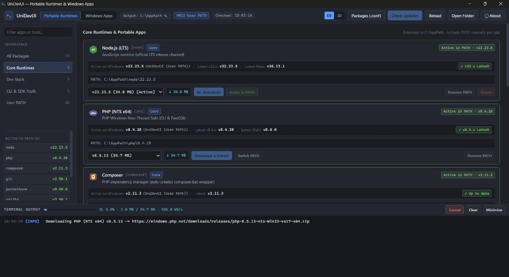

# UniDevUI

**Bahasa / Language:** [English](README.md) | [Bahasa Indonesia](README.id.md)

**UniDevUI** adalah aplikasi utilitas desktop Windows portabel berbasis **Go + Wails v2 + Vanilla TypeScript** untuk menyiapkan runtime pemrograman secara rapi tanpa mengotori sistem operasi, sekaligus mengotomatiskan instalasi silent, pembaruan, dan penguncian versi (*pin*) aplikasi Windows melalui **Winget**.

---

## Tampilan Aplikasi

### Portable Runtimes & Manajemen User PATH


### Katalog Windows Apps (`Windows Apps`)


### Aplikasi Terpasang, Update Sistem & Progress ConPTY


---

## Fitur Utama

### 1. Portable Runtimes & CLI / SDK Tools (`Portable Runtimes`)
- **Ekstraksi Arsip Portabel (default `C:\AppPath`, dapat diubah):**
  Mengunduh dan mengekstrak arsip resmi ZIP / TAR.GZ / TAR.XZ / PHAR untuk 13 paket bawaan:
  - **Core Runtimes (8):** `node` (Node.js LTS), `php`, `composer`, `go`, `git` (MinGit), `pocketbase`, `sqlite`, `python` (CPython standalone oleh Astral)
  - **Dev Stack & Compiler (5):** `dotnet` (.NET SDK LTS), `rust`, `gcc` (WinLibs GCC/MinGW-w64), `cmake`, `7zip`
- **Manajemen User PATH Aman (`HKCU\Environment`):**
  Mengaktifkan dan mengganti versi aktif langsung di User `PATH` Windows, dilengkapi deteksi konflik biner serta inspektor **User PATH**.
- **Installer CLI & Windows SDK (5):**
  `wails2`, `wails3`, `tauri`, `vsbuildtools` (Visual Studio Build Tools 2022), dan `webview2` (Microsoft Edge WebView2 Runtime).
- **Cek Rilis Resmi & Ukuran File:**
  Perbarui link versi LTS/stabil terbaru langsung dari sumber resmi (`Check Updates`), lihat estimasi ukuran unduhan yang tersimpan di cache lokal, dan pantau progress unduhan langsung pada header terminal.

### 2. Windows Apps, Katalog Winget & Update Aplikasi (`Windows Apps`)
- **27 Aplikasi Esensial Kurasi** dalam 6 kategori (`browsers`, `utilities`, `editors`, `office`, `chat`, `downloaders`), termasuk pilihan multi-versi seperti **Laragon** (`6.0.0` tanpa popup lisensi atau `latest`).
- **Deteksi Cerdas di Windows:** Mencocokkan aplikasi yang sudah terpasang lewat `winget list` maupun Registry Uninstall Windows.
- **Pencarian Katalog Winget & Modal Detail:** Cari aplikasi apa pun dari repositori `winget` dan `msstore`, lihat penerbit, situs resmi, lisensi, tipe installer, tanggal rilis, SHA256, ukuran installer, dan ikon, lalu install silent atau tambahkan ke daftar (`+ Add to List`).
- **Menu `Installed & Updates` / `Terpasang & Update`:**
  Memindai semua aplikasi terpasang di PC lewat `winget list` dengan 3 filter cepat (**`Perlu Update`**, **`Semua Terpasang`**, **`Diabaikan`**), tombol **`Update`** per aplikasi, **`Update Semua`** secara berurutan, **`Abaikan`**, dan **`Pulihkan`**.
- **Daftar Abaikan Portabel (`ignored_updates.conf`) + `winget pin` Windows:**
  Aplikasi yang diabaikan akan disembunyikan dari daftar **`Perlu Update`** & **`Semua Terpasang`** (dan tidak memicu status update kuning di kartu Windows Apps, sementara tombol **`Fix`** dan pemilihan versi seperti Laragon `6.0.0` tetap aktif), tersimpan di `ignored_updates.conf` di sebelah `UniDevUI.exe`, serta otomatis mengunci paket lewat `winget pin add --blocking` untuk ID Winget/MS Store.
- **Progress Bar Header Bersih & Antarmuka Dwibahasa:**
  Memanfaatkan Windows ConPTY (`CreatePseudoConsole`) agar persentase, jumlah MB, dan kecepatan download Winget tampil rapi di header tanpa membanjiri log terminal, serta mendukung ganti bahasa instan **Inggris (`en`)** dan **Indonesia (`id`)**.

---

## Lokasi Berkas Konfigurasi & Penyimpanan

Berkas konfigurasi `.conf` disimpan secara portabel **di folder yang sama dengan `UniDevUI.exe`** dan dipantau otomatis bila diedit dari luar (misalnya dengan Notepad):

| Berkas | Lokasi | Fungsi |
| :--- | :--- | :--- |
| `packages.conf` | Di sebelah `UniDevUI.exe` | Daftar paket runtime portabel beserta versi dan URL unduhannya |
| `essentials.conf` | Di sebelah `UniDevUI.exe` | Daftar aplikasi Windows Apps kurasi (bisa ditambah lewat UI atau Notepad) |
| `ignored_updates.conf` | Di sebelah `UniDevUI.exe` | Daftar aplikasi yang diabaikan dari update/daftar terpasang + status Winget Pin |
| `settings.json` | `%APPDATA%\UniDevUI\` | Folder tujuan ekstraksi (`BaseDir`) dan bahasa antarmuka (`en`/`id`) |
| `size_cache.json` | `%APPDATA%\UniDevUI\` | Cache ukuran file unduhan (`Content-Length`) |

---

## Teknologi & Struktur Proyek

- **Backend:** Go (`1.26.0`), Wails v2 (`v2.17.1`), `golang.org/x/sys`, `github.com/ulikunitz/xz`
- **Frontend:** Vanilla TypeScript (`^5.6.3`), Vite (`^7.0.0`)

```text
UniDevUI/
├── main.go                     # Entry point jendela desktop Wails & lifecycle
├── app.go                      # Binding backend, task runner, file watcher, dan orkestrasi state
├── wails.json                  # Konfigurasi build Wails
├── frontend/                   # UI WebView TypeScript + Vite serta binding Wails
└── internal/
    ├── archive/                # Downloader HTTP, event progress, ekstraksi zip/tar.gz/tar.xz/phar
    ├── config/                 # Parser/updater packages.conf & penyimpanan settings.json
    ├── essentials/             # essentials.conf, ignored_updates.conf, deteksi registry/winget, runner ConPTY
    ├── lts/                    # Cek versi LTS/stabil terbaru & cache ukuran unduhan
    ├── pathmgr/                # Manajemen HKCU User PATH, probe versi biner, helper semver
    └── tools/                  # Installer Wails CLI, Tauri CLI, VS Build Tools, dan WebView2
```

---

## Cara Build & Menjalankan dari Source

### Prasyarat (Windows 10 / 11)
1. **Go** (direkomendasikan 1.26+)
2. **Node.js** & **npm**
3. **Wails CLI v2** (`go install github.com/wailsapp/wails/v2/cmd/wails@v2.17.1`)
4. **Microsoft Edge WebView2 Runtime** (umumnya sudah terpasang di Windows 11)
5. *(Opsional untuk fitur Tab 2)* **Windows App Installer (`winget`)**

### Perintah Pengembangan & Build

```powershell
# Jalankan mode pengembangan (live reload)
wails dev

# Cek tipe TypeScript & bundle frontend secara manual
cd frontend
npm install
npm run build
cd ..

# Jalankan unit test cepat
go test -v -short -count=1 ./...

# Build aplikasi tunggal (.exe) siap pakai -> build/bin/UniDevUI.exe
wails build -clean
```

---

## Rilis Otomatis via GitHub Releases

Setiap push tag versi (`v*`, misalnya `v1.0.0`) otomatis menjalankan workflow [`.github/workflows/release.yml`](.github/workflows/release.yml) di runner `windows-latest` untuk menjalankan unit test, mem-build `UniDevUI.exe`, mengemas `UniDevUI-windows-amd64.zip`, dan menerbitkan GitHub Release secara otomatis.

---

## Pembuat & Kontak

- **Author:** AKZ Team
- **Email:** [aozora@botsec.dev](mailto:aozora@botsec.dev)
- **Telegram:** [https://t.me/AozoraKZ](https://t.me/AozoraKZ)

---

## Lisensi

Proyek ini menggunakan **MIT License** — lihat [LICENSE](LICENSE) (naskah resmi Bahasa Inggris) atau [LICENSE-ID.md](LICENSE-ID.md) (terjemahan Bahasa Indonesia).
