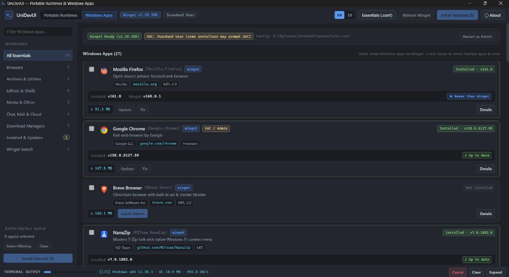

# UniDevUI

**Language / Bahasa:** [English](README.md) | [Bahasa Indonesia](README.id.md)

**UniDevUI** is a portable Windows desktop utility built with **Go + Wails v2 + Vanilla TypeScript** for setting up developer runtimes cleanly without polluting the OS, and automating silent Windows application installs, updates, and version pins via **Winget**.

---

## Screenshots

### Portable Runtimes & User PATH Management


### Windows Apps Catalog (`Windows Apps`)


### Installed Apps, System Updates & ConPTY Progress


---

## Features

### 1. Portable Runtimes & CLI / SDK Tools (`Portable Runtimes`)
- **Portable Archive Extraction (`C:\AppPath` by default, configurable):**
  Extracts official ZIP / TAR.GZ / TAR.XZ / PHAR archives for 13 built-in packages:
  - **Core Runtimes (8):** `node` (Node.js LTS), `php`, `composer`, `go`, `git` (MinGit), `pocketbase`, `sqlite`, `python` (Astral standalone CPython)
  - **Dev Stack & Compilers (5):** `dotnet` (.NET SDK LTS), `rust`, `gcc` (WinLibs GCC/MinGW-w64), `cmake`, `7zip`
- **Safe User PATH Management (`HKCU\Environment`):**
  Activate/switch versions per runtime in Windows User `PATH` with conflict detection against existing System/User binaries and a live **User PATH Inspector**.
- **CLI & Windows SDK Tools (5):**
  `wails2`, `wails3`, `tauri`, `vsbuildtools` (Visual Studio Build Tools 2022), and `webview2` (Microsoft Edge WebView2 Runtime).
- **Live Upstream Checks & Download Sizes:**
  Check latest stable/LTS releases directly from upstream providers (`Check Updates`), inspect download sizes cached locally, and watch live header download progress bars.

### 2. Windows Apps, Winget Catalog & System Updates (`Windows Apps`)
- **27 Curated Essential Apps** across 6 categories (`browsers`, `utilities`, `editors`, `office`, `chat`, `downloaders`), including multi-version options such as **Laragon** (`6.0.0` without license popup or `latest`).
- **Smart Local Detection:** Matches already-installed Windows apps across both `winget list` and Windows Uninstall Registry entries (handling browser/editor ID mismatches cleanly).
- **Winget Catalog Search & Details Modal:** Search any package across `winget` and `msstore`, preview publisher, homepage, license, installer type, release date, SHA256, file size, and icon, silent-install on demand, or pin to `essentials.conf` (`+ Add to List`).
- **Installed & Updates Manager:**
  Scans installed Windows apps via `winget list` with three quick filters (`Updates Available`, `All Installed`, `Ignored`), per-app **`Update`**, sequential **`Update All`**, **`Ignore`**, and **`Restore`**.
- **Portable `ignored_updates.conf` + Windows `winget pin`:**
  Ignoring an app hides it from `Updates Available` / `All Installed` (and suppresses update prompts on curated cards while keeping `Fix`/version reinstall working), writes to `ignored_updates.conf` beside `UniDevUI.exe`, and automatically sets a blocking pin via `winget pin add --blocking` for Winget/MS Store IDs.
- **Clean Header Progress & Bilingual UI:**
  Uses Windows ConPTY (`CreatePseudoConsole`) so Winget download percentages, bytes downloaded, and speed render smoothly in the top header progress bar, with instant **English (`en`)** and **Indonesian (`id`)** switching.

---

## Configuration & Storage Locations

Configuration files are stored portably **next to `UniDevUI.exe`** and watched for live external edits:

| File | Location | Purpose |
| :--- | :--- | :--- |
| `packages.conf` | Next to `UniDevUI.exe` | Portable runtime packages and downloadable versions/URLs |
| `essentials.conf` | Next to `UniDevUI.exe` | Curated Windows Apps list (customizable via UI or Notepad) |
| `ignored_updates.conf` | Next to `UniDevUI.exe` | Ignored apps excluded from updates/installed lists + Winget pin state |
| `settings.json` | `%APPDATA%\UniDevUI\` | Active extraction output folder (`BaseDir`) and UI language (`en`/`id`) |
| `size_cache.json` | `%APPDATA%\UniDevUI\` | Cached installer/archive file sizes (`Content-Length`) |

---

## Tech Stack & Project Structure

- **Backend:** Go (`1.26.0`), Wails v2 (`v2.17.1`), `golang.org/x/sys`, `github.com/ulikunitz/xz`
- **Frontend:** Vanilla TypeScript (`^5.6.3`), Vite (`^7.0.0`)

```text
UniDevUI/
├── main.go                     # Wails desktop window & lifecycle entry point
├── app.go                      # Backend bindings, task runner, watchers, and state orchestration
├── wails.json                  # Wails build configuration
├── frontend/                   # TypeScript + Vite webview UI and generated Wails bindings
└── internal/
    ├── archive/                # HTTP downloader, progress events, zip/tar.gz/tar.xz/phar extraction
    ├── config/                 # Portable packages.conf parser/updater & settings.json persistence
    ├── essentials/             # essentials.conf, ignored_updates.conf, registry/winget matching, ConPTY runner
    ├── lts/                    # Upstream LTS/release updaters and HTTP size cache
    ├── pathmgr/                # HKCU User PATH manipulation, binary version probing, semver helpers
    └── tools/                  # Wails CLI, Tauri CLI, VS Build Tools, and WebView2 installers
```

---

## Build & Run from Source

### Prerequisites (Windows 10 / 11)
1. **Go** (1.26+ recommended)
2. **Node.js** & **npm**
3. **Wails CLI v2** (`go install github.com/wailsapp/wails/v2/cmd/wails@v2.17.1`)
4. **Microsoft Edge WebView2 Runtime** (pre-installed on Windows 11)
5. *(Optional runtime feature)* **Windows App Installer (`winget`)** for Windows Apps & system update features

### Commands

```powershell
# Run in live development mode
wails dev

# Type-check and bundle frontend manually
cd frontend
npm install
npm run build
cd ..

# Run unit tests (fast offline/local checks)
go test -v -short -count=1 ./...

# Build standalone portable executable -> build/bin/UniDevUI.exe
wails build -clean
```

---

## Automated GitHub Releases

Pushing a version tag (`v*`, for example `v1.0.0`) triggers [`.github/workflows/release.yml`](.github/workflows/release.yml) on `windows-latest` to run tests, build `UniDevUI.exe`, package `UniDevUI-windows-amd64.zip`, and publish a GitHub Release automatically.

---

## Author & Contact

- **Author:** AKZ Team
- **Email:** [aozora@botsec.dev](mailto:aozora@botsec.dev)
- **Telegram:** [https://t.me/AozoraKZ](https://t.me/AozoraKZ)

---

## License

This project is licensed under the **MIT License** — see [LICENSE](LICENSE) (official English text) or [LICENSE-ID.md](LICENSE-ID.md) (Indonesian translation).
