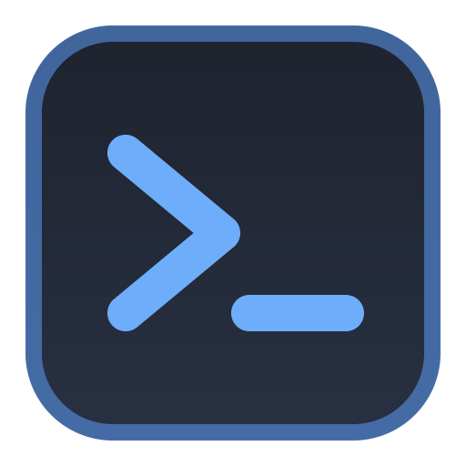
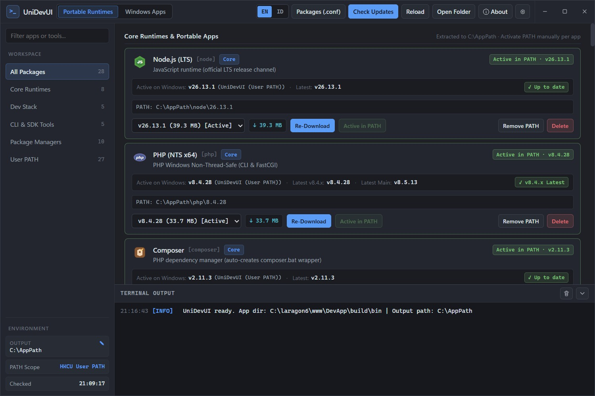
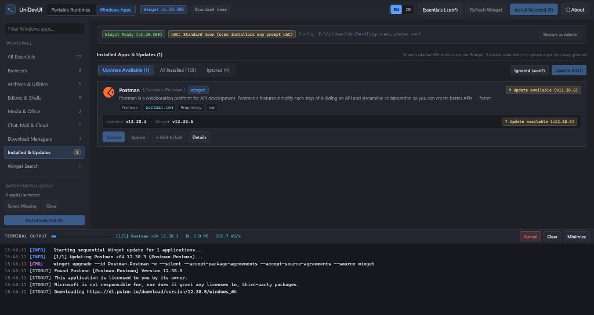
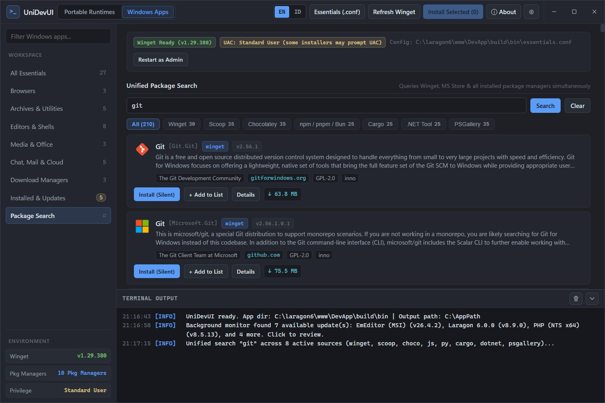
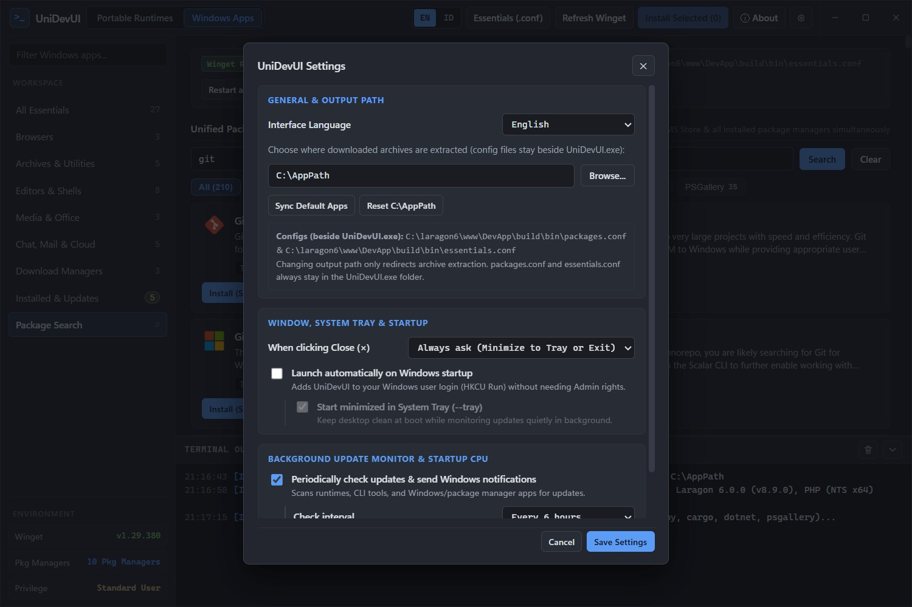

<div align="center">



# UniDevUI

**Portable Windows Developer Runtimes, Multi-Manager Package Hub & Quiet System Tray Updater**

[English](README.md) · [Bahasa Indonesia](README.id.md) · [Changelog](CHANGELOG.md) · [Releases](https://github.com/aozora-kenzu/UniDevUI/releases)

[](https://github.com/aozora-kenzu/UniDevUI/releases/latest)
[](https://github.com/aozora-kenzu/UniDevUI/actions/workflows/release.yml)
[-0078D6?style=for-the-badge&logo=windows&logoColor=white)](https://github.com/aozora-kenzu/UniDevUI/releases)
[](go.mod)
[](wails.json)
[](frontend/package.json)
[](LICENSE)
[](https://github.com/aozora-kenzu/UniDevUI/releases)
[](https://github.com/aozora-kenzu/UniDevUI/graphs/contributors)

</div>

---

**UniDevUI** is a lightweight, single-executable Windows desktop utility crafted with **Go + Wails v2 + Vanilla TypeScript**. It gives developers a clean portable workspace (`C:\AppPath` by default) to install and switch programming runtimes in `HKCU\Environment` User `PATH` without polluting the OS, alongside a unified Winget + CLI package manager hub, ConPTY streaming progress, and a low-footprint System Tray background update monitor.

---

## Screenshots

### 1. Portable Runtimes, CLI Tools & Safe User PATH Workspace
Manage extracted runtime versions (`node`, `php`, `composer`, `go`, `git`, `python`, `dotnet`, `rust`, etc.), CLI/SDK tools, 10 package managers, and `HKCU` User `PATH` entries in a clean frameless dark interface with a scoped terminal drawer.



### 2. Curated Windows Apps (`Windows Apps`)
Checkboxes for batch installation via header `Install Selected`, UAC indicators, local Registry + Winget cross-detection, and side-by-side `Installed` vs `Winget Latest` version comparisons across 27 curated essentials.


### 3. Installed Apps, Updates & Granular Update Controls
Inspect installed apps and packages across **Winget** and **CLI package managers**, update individually or sequentially with **`Update All`**, **Skip Version (`Skip v...`)**, **Pause Updates for 7 Days (`Pause 7d`)**, or **Ignore + Winget Blocking Pin**.



### 4. Unified Multi-Source Package Search
Stream concurrent search results across **Winget**, **Microsoft Store**, **Scoop**, **Chocolatey**, **npm / pnpm / Bun**, **PyPI (`pip` / `uv`)**, **Cargo**, **.NET Tools**, and **PowerShell Gallery**, enriched with publisher metadata, installer size, and UniGetUI package icons.



### 5. Settings: System Tray, Quiet Startup (`--tray`) & CPU Throttling
Configure output extraction path, close behavior (`Ask`, `Minimize to Tray`, `Exit`), silent Windows login auto-start (`--tray`), and periodic background update intervals without Registry hacks or admin prompts.



---

## Key Features

### Portable Runtimes, Compilers & `HKCU` User PATH
- **13 Built-in Portable Archive Packages** extracted cleanly into customizable subdirectories (default `C:\AppPath`):
  - **Core Runtimes (8):** `node` (Node.js LTS), `php` (NTS x64), `composer` (auto-generates `composer.bat`), `go`, `git` (MinGit), `pocketbase`, `sqlite`, `python` (Astral standalone CPython + `pip.bat`)
  - **Dev Stack & Compilers (5):** `dotnet` (.NET SDK LTS), `rust`, `gcc` (WinLibs GCC/MinGW-w64), `cmake`, `7zip`
- **Safe `HKCU\Environment` User `PATH` Manager:** Switch active runtime versions instantly, detect conflicting system/global binaries, reorder entries, clean stale paths, or browse folders directly.
- **5 Developer CLI & SDK Installers:** `wails2`, `wails3`, `tauri`, `vsbuildtools` (Visual Studio 2022 Build Tools), and `webview2` (Edge WebView2 Runtime).
- **10 Package Manager Integrations:** Built-in detection, installation, and status inspection for `scoop`, `choco`, `npm`, `pnpm`, `bun`, `uv`, `pip`, `cargo`, `dotnet`, and `psgallery` (including `.bat`/`.cmd` shims and skipping 0-byte WindowsApps stubs).

### Unified Windows Apps & Multi-Manager Hub
- **27 Curated Essential Apps** across 6 categories (`browsers`, `utilities`, `editors`, `office`, `chat`, `downloaders`), including multi-version selections such as **Laragon** (`6.0.0` or `latest`).
- **Unified Streaming Search:** Search **Winget**, **MS Store**, **Scoop**, **Chocolatey**, **npm/pnpm/Bun**, **uv/pip**, **Cargo**, **.NET Tools**, and **PSGallery** concurrently with live progress chips and rich Details modals (icon, publisher, license, homepage, release notes, dependencies, SHA256, size).
- **Granular Update Policy (`ignored_updates.conf`):**
  - **Skip Specific Version:** Suppresses notifications only for the skipped release while alerting again on newer versions.
  - **Pause Temporarily (`Pause 7d`):** Sets a date-bound `pause_until` suppression that auto-resumes after 7 days (or manually via **Resume Updates**).
  - **Permanent Ignore & Winget Blocking Pin:** Automatically runs `winget pin add --blocking` for Winget/MS Store IDs.
- **Windows ConPTY (`CreatePseudoConsole`):** Renders smooth live download percentages, MB counters, and transfer throughput in the header progress bar without spamming terminal logs.

### Quiet System Tray Daemon & Windows Power Optimizations *(New in v1.1.2)*
- **True Silent Windows Startup (`--tray`):** Starts hidden in the System Tray at Windows login (`HKCU\Software\Microsoft\Windows\CurrentVersion\Run`), ignoring duplicate `--tray` launches so your desktop stays distraction-free until you open UniDevUI intentionally.
- **Dynamic Colored Tray Status Badges:** Renders 32×32 PNG-in-ICO tray variants on the fly — default icon (`idle`), **Green** (updates ready + menu counter, auto-cleared at 0 updates), **Blue** (task active), and **Orange** (warnings/errors).
- **Quick Navigation Tray Menu:** Jump straight to `Runtimes & Dev Stack`, `Updates (N)`, or `Search Packages`, run `Check Updates Now`, or toggle `Start with Windows (--tray)`.
- **Windows Efficiency Mode (EcoQoS) & Memory Trimming:** Automatically applies `ProcessPowerThrottling` (`ExecutionSpeed`) while minimized/hidden & idle, disengaging on focus/restore or task execution, and calls `debug.FreeOSMemory()` after heavy scans and tray hides.
- **OS Shutdown Hook & Smart Protections:** Handles `WM_QUERYENDSESSION`/`WM_ENDSESSION` so Windows shutdowns bypass close confirmation prompts cleanly, defers scans when offline or in Windows Battery Saver mode, enforces persistent `lastCheckUnix` startup cooldowns across reboots, and suppresses OS toast notifications when the UI is already open in front of you.
- **Built-in Self-Updater & Bilingual UI:** Instant **English (`en`)** and **Indonesian (`id`)** switching plus one-click GitHub Release update checks in **About**.

---

## Configuration & Storage Locations

| File | Location | Purpose |
| :--- | :--- | :--- |
| `packages.conf` | Next to `UniDevUI.exe` | Portable runtime packages, versions, and upstream archive URLs |
| `essentials.conf` | Next to `UniDevUI.exe` | Curated Windows Apps list (editable in Notepad with hot reload) |
| `ignored_updates.conf` | Next to `UniDevUI.exe` | Ignored apps, skipped versions, temporary `pause_until` dates, and Winget pin state |
| `settings.json` | `%APPDATA%\UniDevUI\` | Output directory, language, close behavior, auto-start `--tray`, monitor interval, `lastCheckUnix` |
| `size_cache.json` | `%APPDATA%\UniDevUI\` | Cached remote installer/archive file sizes (`Content-Length`) |
| `icon_database_v2.json` | `%APPDATA%\UniDevUI\` | Cached package icon metadata database |
| `app_update_cache.json` | `%APPDATA%\UniDevUI\` | Cached GitHub latest release check metadata |

---

## Architecture Overview

```text
UniDevUI/
├── main.go                     # Wails frameless window, --tray hidden boot & SingleInstanceLock
├── app.go                      # Backend bindings, task runner, EcoQoS sync, close/tray lifecycle
├── monitor.go                  # Startup throttling, persistent cooldown, background monitor & smart toasts
├── wails.json                  # Wails project metadata & version info
├── frontend/                   # TypeScript + Vite WebView UI and generated Wails bindings
└── internal/
    ├── archive/                # HTTP downloader, progress events, zip/tar.gz/tar.xz/phar extraction
    ├── autostart/              # HKCU Run startup entry management (--tray parsing & Registry sync)
    ├── config/                 # packages.conf parser/updater & settings.json persistence
    ├── essentials/             # essentials.conf, ignored_updates.conf, Registry/Winget match, ConPTY runner
    ├── lts/                    # Upstream LTS/stable feed checkers & installer size cache
    ├── pathmgr/                # HKCU User PATH management, binary version probing & semver comparisons
    ├── pkgmgr/                 # Multi-manager adapters (Scoop, Choco, npm/pnpm/Bun, uv/pip, Cargo, .NET, PSGallery)
    ├── selfupdate/             # GitHub Release update checker & live binary swapper
    ├── syspower/               # Win32 EcoQoS ProcessPowerThrottling, Battery Saver & network checks
    ├── tools/                  # Wails/Tauri/VS Build Tools/WebView2 & 10 pkg manager environment probes
    └── tray/                   # Win32 Shell_NotifyIconW, dynamic colored badges, context menu & shutdown hooks
```

---

## Build & Run from Source

### Prerequisites (Windows 10 / 11)
1. **Go** `1.26+`
2. **Node.js** `22+` & **npm**
3. **Wails CLI v2** (`go install github.com/wailsapp/wails/v2/cmd/wails@v2.17.1`)
4. **Microsoft Edge WebView2 Runtime**
5. *(Optional)* **Windows App Installer (`winget`)**

### Commands

```powershell
# Live development mode
wails dev

# Type-check & build frontend manually
cd frontend
npm install
npm run build
cd ..

# Run fast offline/local unit tests
go test -v -short -count=1 ./...

# Build standalone portable binary -> build/bin/UniDevUI.exe
wails build -clean
```

---

## Contributors

<a href="https://github.com/aozora-kenzu/UniDevUI/graphs/contributors">
  
</a>

---

## Author, Links & License

- **Author:** AKZ Team
- **Email:** [aozora@botsec.dev](mailto:aozora@botsec.dev)
- **Telegram:** [https://t.me/AozoraKZ](https://t.me/AozoraKZ)
- **Website:** [https://botsec.dev](https://botsec.dev)
- **License:** MIT License — see [LICENSE](LICENSE) (English) or [LICENSE-ID.md](LICENSE-ID.md) (Bahasa Indonesia).
